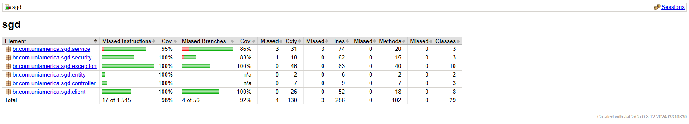

# JaCoCo — Relatório final de cobertura

Meta do projeto: **≥ 90% de instruções cobertas**. O `pom.xml` reprova o build (`jacoco:check`) abaixo disso.
Ficam fora da contagem só `SgdApplication`, o pacote `config` e o pacote `dto`, e o código gerado pelo Lombok
(`lombok.addLombokGeneratedAnnotation = true` no `lombok.config`).

## Como gerar

Com o Docker aberto (os testes de integração sobem um PostgreSQL com Testcontainers) e o JDK 17:

```bash
cd backend
./mvnw clean verify
```

O relatório fica em `backend/target/site/jacoco/index.html`. Como a pasta `target/` não vai para o Git nem para o
ZIP, a evidência da entrega é o print do `index.html`, salvo em `docs/img/jacoco.png`.

## Resultado

- Data: 04/11/2026
- Commit: `ade2d4c` (`develop`), mais a correção do `pom.xml` da branch `docs/resultados-testes`
- Testes: 87 unitários e 46 de integração, 0 falhas
- Cobertura total (instruções): **98,9%** (17 de 1.545 instruções sem cobertura)
- Cobertura de desvios (*branches*): **92,9%** (4 de 56 desvios sem cobertura)

| Pacote | Instruções | Desvios | Dono |
|---|---|---|---|
| `controller` | 100% | sem desvios | Integrantes 1, 2, 3 e 5 |
| `service` | 95,9% | 86,4% | Integrantes 1, 2, 3 e 5 |
| `security` | 100% | 83,3% | Integrante 1 |
| `entity` | 100% | sem desvios | Integrantes 2 e 3 |
| `repository` | não aparece (só interfaces) | — | Integrantes 2 e 3 |
| `exception` | 100% | 100% | Integrante 4 |
| `client` | 100% | 100% | Integrante 4 |

O print mostra os percentuais arredondados para baixo (95% e 98%, por exemplo); os valores com uma casa decimal
saem do `jacoco.csv` gerado junto com o relatório.



## Análise

A meta de 90% foi atingida com folga: 98,9% das instruções e 92,9% dos desvios estão cobertos, e cinco dos seis
pacotes medidos estão com 100% das instruções. Os testes cobrem de ponta a ponta as cinco regras de negócio, o
formato único de erro (`ErrorResponse`) e a integração com a API da faculdade (Feign e mock).

O que ainda não está coberto se resume a quatro desvios, todos em `if`s:

| Arquivo e linha | Trecho | O que falta testar |
|---|---|---|
| `DemandaService.java:71` | `if (request.versao() == null)` | Editar uma demanda **sem enviar a versão** (deve dar 400). |
| `DemandaService.java:81` | `if (existsByTituloIgnoreCaseAndEmpresaIdAndIdNot(...))` | Editar uma demanda colocando o **título de outra demanda da mesma empresa** (deve dar 409). |
| `DemandaService.java:129` | `if (titulo != null && !titulo.isBlank())` | Listar com o filtro de título **só com espaços** (deve ignorar o filtro). |
| `JwtAuthFilter.java:32` | `if (header != null && header.startsWith(BEARER))` | Requisição com cabeçalho `Authorization` **que não começa com `Bearer `** (ex.: `Basic ...`). |

As 17 instruções sem cobertura são as linhas de dentro dos dois primeiros `if`s (o `throw` e o `log.warn`). O
primeiro caso já é exercitado pelo teste de carga do JMeter (cenário 4, `PUT` sem versão → 400), mas o JMeter não
conta para a cobertura. Faltam os testes automatizados desses dois casos no `DemandaServiceTest`, que eram os testes
novos previstos para o módulo do Integrante 2.
